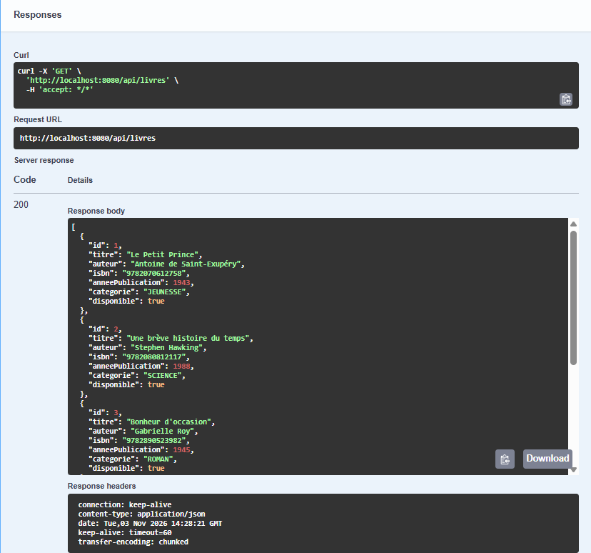
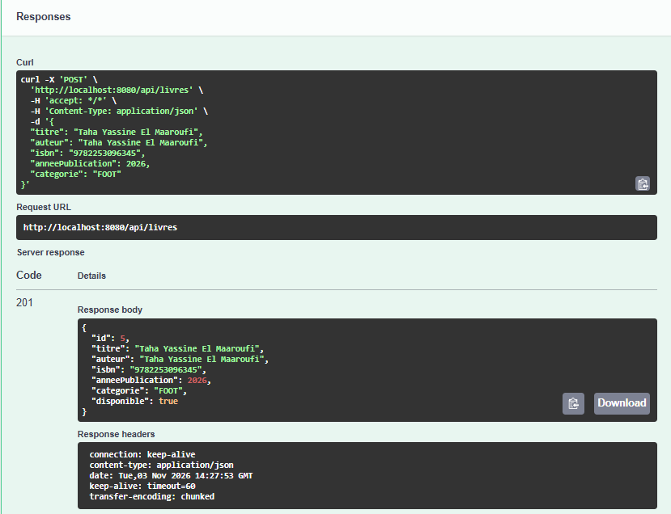
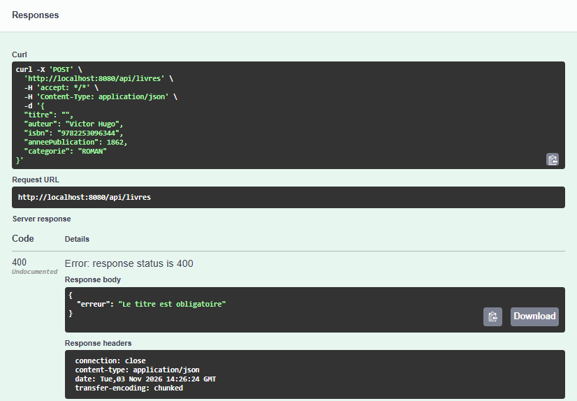
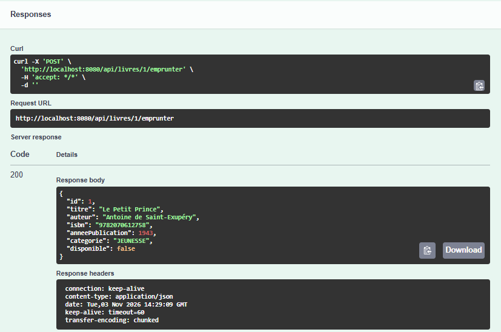
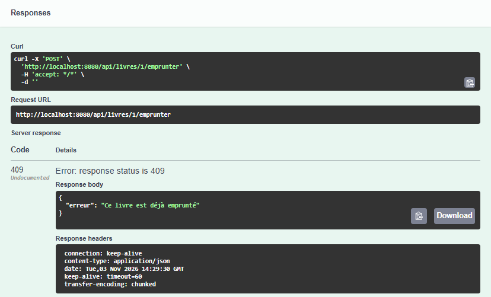

# biblio-api

API REST de gestion d'une petite bibliothèque (Spring Boot 3.5, Java 25, architecture MVC).

---

## Sommaire
- [Structure du projet](#structure-du-projet)
- [Endpoints](#endpoints)
- [Partie A — Lecture de code et tests Swagger](#partie-a--lecture-de-code-et-tests-swagger)
- [Partie B — Pipeline CI GitHub Actions](#partie-b--pipeline-ci-github-actions)
- [Partie C — Tests unitaires et couverture JaCoCo](#partie-c--tests-unitaires-et-couverture-jacoco)
- [Partie D — Code Smells et Réusinage](#partie-d--code-smells-et-réusinage)
- [Partie E — Docker, Codespaces, GHCR et Livraison SemVer](#partie-e--docker-codespaces-ghcr-et-livraison-semver)
- [Partie F — Liens de remise](#partie-f--liens-de-remise)

---

## Structure du projet

| Package | Rôle |
|---|---|
| `model` | Le modèle : `Livre` |
| `repository` | Accès aux données (en mémoire) |
| `service` | Logique métier |
| `controller` | Contrôleur REST (+ `LivreRequest`, corps JSON des requêtes) |
| `exception` | Exceptions et traduction en codes HTTP |

---

## Endpoints

| Méthode | URL | Description |
|---|---|---|
| GET | `/api/livres` | Lister les livres |
| GET | `/api/livres/{id}` | Obtenir un livre |
| POST | `/api/livres` | Ajouter un livre |
| PUT | `/api/livres/{id}` | Modifier un livre |
| DELETE | `/api/livres/{id}` | Supprimer un livre |
| POST | `/api/livres/{id}/emprunter` | Emprunter un livre |
| POST | `/api/livres/{id}/retourner` | Retourner un livre |
| GET | `/api/livres/{id}/frais-retard?joursRetard=N` | Frais de retard en $ |

---

## Partie A — Lecture de code et tests Swagger

### A.1 Lecture de code

1. **Quelle classe joue le rôle du Modèle, du Contrôleur ? Où se trouve la logique métier ?**
   - **Modèle** : La classe `Livre` (représente l'entité et transporte les données d'un livre).
   - **Contrôleur** : La classe `LivreController` (reçoit les requêtes HTTP, valide la forme des requêtes et délègue au service).
   - **Logique métier** : La classe `LivreService` (applique les règles d'affaires telles que la validation des champs, l'emprunt, le retour et le calcul des frais de retard).

2. **Que fait `GestionnaireErreurs` et quel code HTTP obtient-on pour un livre introuvable ? Et pour un double emprunt ?**
   - `GestionnaireErreurs` est un `@RestControllerAdvice` qui intercepte les exceptions métier levées par les services et les transforme en réponses HTTP structurées au format JSON avec un statut adéquat.
   - Livre introuvable (`LivreIntrouvableException`) : **Code HTTP 404 (Not Found)**.
   - Double emprunt (`IllegalStateException`) : **Code HTTP 409 (Conflict)**.

3. **Où les données sont-elles stockées ? Que se passe-t-il quand l'application redémarre ?**
   - Les données sont stockées **en mémoire** dans une collection `ConcurrentHashMap` située dans la classe `LivreRepository`.
   - Il n'y a pas de base de données persistante : au redémarrage de l'application, tous les ajouts, modifications ou emprunts sont perdus et l'état revient aux 3 livres initiaux codés en dur.

4. **Suivez le trajet complet d'un appel `POST /api/livres/1/emprunter` : quelles classes/méthodes sont appelées, dans quel ordre ?**
   1. `LivreController.emprunter(1L)` reçoit la requête HTTP POST.
   2. Le contrôleur appelle la méthode métier `LivreService.emprunter(1L)`.
   3. `LivreService` appelle sa méthode `trouver(1L)` qui invoque `LivreRepository.findById(1L)`. Si le livre n'existe pas, `LivreIntrouvableException` est levée (traduite en 404 par `GestionnaireErreurs`).
   4. `LivreService` vérifie la disponibilité : si `!livre.isDisponible()`, une `IllegalStateException` est levée (traduite en 409).
   5. Si disponible, `livre.setDisponible(false)` est appliqué, puis `LivreRepository.save(livre)` sauvegarde la mise à jour en mémoire.
   6. Le livre mis à jour remonte au contrôleur qui retourne un **code HTTP 200 (OK)** avec le livre dans le corps de réponse.

---

### A.3 Tests avec Swagger

| # | Appel | Résultat attendu vérifié | Code HTTP | Explication du code | Capture |
|---|---|---|---|---|---|
| 1 | `GET /api/livres` | Liste des 3 livres initiaux | **200** | **OK** : La ressource demandée a été trouvée et retournée avec succès. |  |
| 2 | `POST /api/livres` (nouveau livre) | Nouveau livre créé avec ID attribué | **201** | **Created** : La ressource a été créée avec succès sur le serveur. |  |
| 3 | `POST /api/livres` (titre vide) | Rejet de la requête avec message d'erreur | **400** | **Bad Request** : La requête du client est invalide (titre obligatoire non renseigné). |  |
| 4 | `POST /api/livres/1/emprunter` (2 fois) | 1er emprunt réussi, 2e emprunt refusé | **200 puis 409** | **200 (OK)** au premier appel, puis **409 (Conflict)** au second appel en raison d'un conflit d'état (livre déjà emprunté). |  |
| 5 | `GET /api/livres/2/frais-retard?joursRetard=100` | Montant calculé plafonné à **20.00 $** | **200** | **OK** : Calcul effectué avec succès (100 jours × 0.50$ = 50$, plafonné à 20$ pour la catégorie SCIENCE). |  |

---

## Partie B — Pipeline CI GitHub Actions

Le workflow `.github/workflows/ci.yml` automatise la validation du code à chaque étape :
- **Déclencheurs** : `push` sur la branche `master`, `push` de tags `v*.*.*`, `pull_request` vers `master`, et déclenchement manuel (`workflow_dispatch`).
- **Matrice JDK** : Exécution systématique sur **JDK 21** et **JDK 25** (distribution Temurin avec cache Maven activé).
- **Rétrocompatibilité** : Le projet cible Java 25 dans `pom.xml`. L'argument `-Djava.version=${{ matrix.java }}` permet de valider la compatibilité avec JDK 21.
- **Artefact JAR** : Publication du `.jar` en tant qu'artefact `application-jar`, généré une seule fois sur la version cible **JDK 25**.
- **Artefacts JaCoCo** : Publication des rapports de couverture JaCoCo même en cas d'échec (`if: always()`).

---

## Partie C — Tests unitaires et couverture JaCoCo

### C.1 Tests unitaires implémentés (`LivreServiceTest.java`)
1. **Test simple (sans mock)** :
   - `calculerFraisRetard_longRetard_plafonneLeMontant` : Vérifie que pour un retard de 100 jours dans la catégorie `SCIENCE`, le montant calculé ne dépasse jamais le plafond de 20.00 $.
2. **Test sur exception (`assertThrows`)** :
   - `emprunter_livreDejaEmprunte_lanceIllegalStateException` : Vérifie que tenter d'emprunter un livre dont `disponible == false` lève une `IllegalStateException` et qu'aucun appel à `repository.save()` n'est effectué (`never()`).
3. **Test avec mock Mockito (`when` / `thenReturn` / `verify`)** :
   - `emprunter_livreDisponible_marqueIndisponibleEtSauvegarde` : Vérifie qu'un emprunt valide bascule `disponible` à `false` et invoque exactement une fois `repository.save(livre)` (`times(1)`).

### C.2 Rapport et interprétation JaCoCo

La configuration du plugin `jacoco-maven-plugin` (version 0.8.14 compatible Java 25) produit le rapport HTML dans `target/site/jacoco/index.html`.

**Résumé de la couverture par package :**

| Package | Instructions couvertes | Couverture branches | Lignes couvertes |
|---|---|---|---|
| `ca.cegep.biblio.repository` | 85 % (76 / 89) | 50 % (1 / 2) | 80 % (12 / 15) |
| `ca.cegep.biblio.service` | 28 % (60 / 215) | 15 % (4 / 26) | 30 % (14 / 47) |
| `ca.cegep.biblio.model` | 48 % (38 / 79) | N/A | 47 % (15 / 32) |
| `ca.cegep.biblio.controller` | 0 % (0 / 99) | N/A | 0 % (0 / 17) |
| `ca.cegep.biblio.exception` | 0 % (0 / 32) | N/A | 0 % (0 / 6) |

**Interprétation :**
- Les tests unitaires ciblent directement la logique métier critique (`LivreServiceTest`) et l'accès aux données (`LivreRepositoryTest`).
- Les couches `controller` et `exception` affichent 0 % de couverture car le TP se concentre sur les tests unitaires purs avec mocks et sans chargement du contexte complet (`MockMvc` / `@WebMvcTest`).
- Dans `LivreService`, les méthodes `emprunter` et `calculerFraisRetard` sont bien testées, tandis que les méthodes `creer`, `modifier`, `supprimer` et `retourner` disposent d'un potentiel d'extension de tests.

---

## Partie D — Code Smells et Réusinage

Le catalogue de la semaine 6 a permis d'identifier et de réusiner les code smells suivants :

| Smell identifié | Fichier | Lignes | Pourquoi c'est un problème ? | Réusinage appliqué |
|---|---|---|---|---|
| **Duplicated Code** | `LivreService.java` | 29-37 et 44-52 | La logique de validation (titre, auteur, année de publication) était dupliquée dans les méthodes `creer` et `modifier`, augmentant le risque d'incohérence lors d'une modification. | **Extract Method** : Création d'une méthode privée `valider(String titre, String auteur, int anneePublication)`. |
| **Long Method** | `LivreService.java` | 84-105 | La méthode `calculerFraisRetard` utilisait des `if/else` imbriqués sur 3 niveaux, rendant le flux difficile à suivre et à maintenir. | **Replace with Switch Expression & Extract Method** : Utilisation d'un `switch` moderne et extraction d'une méthode `plafonner(double montant, double plafond)`. |
| **Magic Numbers** | `LivreService.java` | 35, 50, 88-101 | Présence de valeurs littérales sans nommage explicite (ex. 1450, 2100, 0.50, 20, 0.25, 10, etc.), nuisant à la lisibilité et à la maintenance. | **Introduce Constants** : Remplacement par des constantes `private static final` nommées (`ANNEE_MIN`, `ANNEE_MAX`, `TARIF_SCIENCE`, etc.). |
| **Long Parameter List** | `LivreService.java` | 28, 42 | Les méthodes `creer` et `modifier` prennent 5 paramètres distincts, augmentant le risque d'inverser deux arguments du même type. | Regroupement via objet de transfert ou modèle. |

Chaque réusinage a fait l'objet d'un **commit atomique distinct** et tous les tests sont restés **verts**.

---

## Partie E — Docker, Codespaces, GHCR et Livraison SemVer

### E.1 Dockerfile et `.dockerignore`
- **Option A (semaine 7)** : Image d'exécution seulement, basée sur une JRE légère (`eclipse-temurin:25-jre-alpine`).
- **Sécurité** : Exécution sous un utilisateur non-root dédié (`appuser`).
- **Performance** : Utilisation directe du `.jar` déjà produit et testé par le pipeline CI (`COPY target/*.jar app.jar`), sans recompilation inutile dans l'image.
- **Port documenté** : `EXPOSE 8080`.
- **`.dockerignore`** : Exclut le code source, les répertoires git et maven, ainsi que `target/*` tout en préservant explicitement `!target/*.jar`.

### E.2 Commandes de validation (Codespaces / Docker local)
1. **Construction du JAR** :
   ```bash
   ./mvnw -B clean package
   ```
2. **Construction de l'image Docker** :
   ```bash
   docker build -t biblio-api .
   ```
3. **Démarrage du conteneur en arrière-plan** :
   ```bash
   docker run -d -p 8080:8080 --name biblio-app biblio-api
   ```
4. **Validation via requêtes HTTP** :
   ```bash
   curl http://localhost:8080/api/livres
   ```
   Et consultation de l'interface Swagger via le port 8080 redirigé : `http://localhost:8080/swagger-ui.html`.

### E.3 Variables et secrets
Le workflow n'embarque aucune donnée sensible ou identifiant en dur dans le code :
- Registre : `${{ vars.REGISTRY }}` (`ghcr.io`)
- Utilisateur : `${{ vars.GHCR_USER }}` (`yassine3232`)
- Jeton d'authentification : `${{ secrets.GHCR_TOKEN }}`

### E.4 Publication automatique GHCR et Release GitHub
Lors du push d'un tag Git respectant SemVer (ex: `v1.0.0` ou `v1.0.1`) :
1. Le job de build/test valide l'application sur JDK 21 et 25 et produit l'artefact `application-jar`.
2. Le job `docker` télécharge l'artefact, s'authentifie auprès de GHCR et pousse l'image étiquetée dynamiquement :
   `ghcr.io/yassine3232/biblio-api:${{ github.ref_name }}`.
3. Le job `release` crée automatiquement une GitHub Release portant le nom du tag avec le `.jar` attaché en pièce jointe.

### E.5 Justification du versionnage SemVer
- **Tag initial `v1.0.0`** : Première version fonctionnelle livrée avec l'ensemble des endpoints et la couverture de tests initiale.
- **Tag suivant `v1.0.1` (CORRECTIF / PATCH)** :
  - **Justification** : Les changements apportés (réusinage des Code Smells : extraction de méthode de validation, suppression des nombres magiques, simplification de la méthode de frais de retard) constituent une amélioration et une refactorisation interne du code sans modification de l'API publique ni ajout de nouvelles fonctionnalités. Selon la spécification **SemVer 2.0.0**, toute modification interne rétrocompatible sans nouvel endpoint justifie l'incrémentation du numéro de **PATCH** (passage de `1.0.0` à `1.0.1`).

---

## Partie F — Liens de remise

- **Dépôt GitHub** : [https://github.com/Yassine3232/TP_TahaYassineElMaaroufi](https://github.com/Yassine3232/TP_TahaYassineElMaaroufi)
- **Reviewer ajouté** : `sfostine`
- **Pull Requests du projet** :
  - PR #1 (Lecture de code & Swagger) : [PR #1](https://github.com/Yassine3232/TP_TahaYassineElMaaroufi/pull/1)
  - PR #2 (Pipeline CI) : [PR #2](https://github.com/Yassine3232/TP_TahaYassineElMaaroufi/pull/2)
  - PR #3 (Tests unitaires & JaCoCo) : [PR #3](https://github.com/Yassine3232/TP_TahaYassineElMaaroufi/pull/3)
  - PR #4 (Code smells réusinés) : [PR #4](https://github.com/Yassine3232/TP_TahaYassineElMaaroufi/pull/4)
  - PR #5 (Docker, GHCR, Releases, CI Fix & README) : [PR #5](https://github.com/Yassine3232/TP_TahaYassineElMaaroufi/pull/5)
  - PR #6 (Incr�mentation SemVer 1.0.1) : [PR #6](https://github.com/Yassine3232/TP_TahaYassineElMaaroufi/pull/6)
- **Workflow CI (exécutions réussies)** : [Actions](https://github.com/Yassine3232/TP_TahaYassineElMaaroufi/actions)
- **Page des Releases GitHub** : [Releases](https://github.com/Yassine3232/TP_TahaYassineElMaaroufi/releases)
- **Page des Packages GHCR** : [Packages](https://github.com/Yassine3232/TP_TahaYassineElMaaroufi/pkgs/container/biblio-api)
